# Lab8Web
Menghubungkan PHP ke Database

# 📂 Struktur Folder

Lab8Web/
│
├── gambar/
├── koneksi.php
├── index.php
├── tambah.php
├── ubah.php
├── hapus.php
├── style.css
└── README.md

# 🚀 Langkah-Langkah Praktikum

1. Persiapan

Sebelum memulai praktikum, persiapkan beberapa aplikasi yang dibutuhkan, yaitu:

XAMPP sebagai web server.

Visual Studio Code sebagai text editor.

Browser untuk mengakses aplikasi.

Jalankan Apache dan MySQL melalui XAMPP Control Panel.

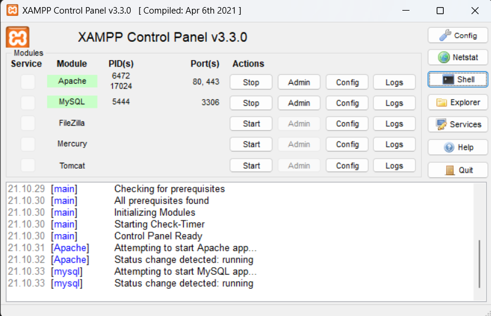

2. Membuat Database

Buka Terminal di conntrol panel XAMPP

ketik : mysql -u root lalu enter

Buat database dengan nama latihan1.

ketik : CREATE DATABASE latihan1; 

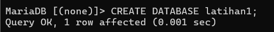

USE latihan1;

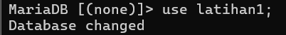

Selanjutnya, buat tabel data_barang dengan struktur berikut:

CREATE TABLE data_barang (
    id_barang INT(10) AUTO_INCREMENT PRIMARY KEY,
    kategori VARCHAR(30),
    nama VARCHAR(30),
    gambar VARCHAR(100),
    harga_beli DECIMAL(10,0),
    harga_jual DECIMAL(10,0),
    stok INT(4)
);

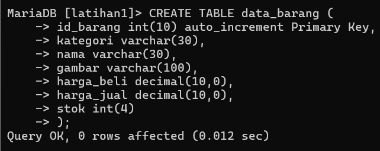

3. Menambahkan Data Awal

Masukkan beberapa data barang ke dalam tabel menggunakan perintah SQL berikut:

INSERT INTO data_barang
(kategori, nama, gambar, harga_beli, harga_jual, stok)
VALUES
('Elektronik', 'HP Samsung Android', 'hp_samsung.jpg', 2000000, 2400000, 5),
('Elektronik', 'HP Xiaomi Android', 'hp_xiaomi.jpg', 1000000, 1400000, 5),
('Elektronik', 'HP OPPO Android', 'hp_oppo.jpg', 1800000, 2300000, 5);

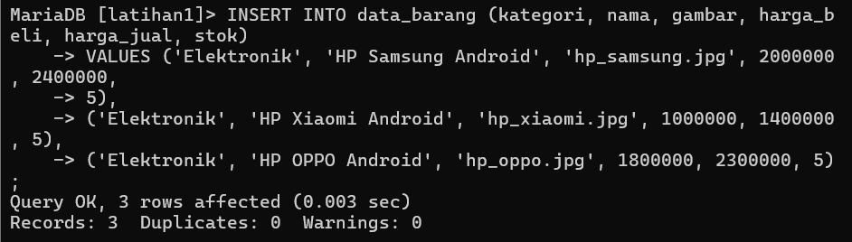

4. Membuat Koneksi Database

Buat file koneksi.php untuk menghubungkan aplikasi PHP dengan database MySQL.

File ini berisi konfigurasi host, username, password, dan nama database. Koneksi dilakukan menggunakan fungsi mysqli_connect().

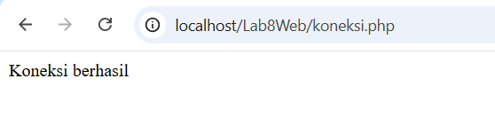

5. Menampilkan Data (Read)

Buat file index.php untuk menampilkan seluruh data barang dari database.

Proses menampilkan data menggunakan perintah SQL SELECT dan fungsi mysqli_query().

Data yang ditampilkan meliputi:

Gambar barang

Nama barang

Kategori

Harga jual

Harga beli

Stok

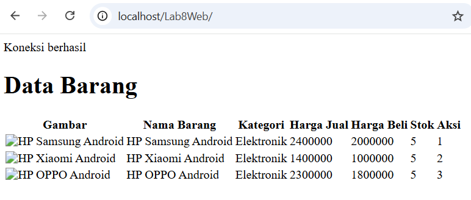

6. Menambahkan Data (Create)

Buat file tambah.php untuk menambahkan barang baru ke dalam database.

Pada halaman ini terdapat formulir untuk mengisi:

Nama barang

Kategori

Harga jual

Harga beli

Stok

File gambar

Data yang dimasukkan akan disimpan ke database menggunakan perintah SQL INSERT.

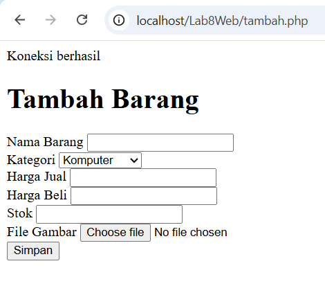

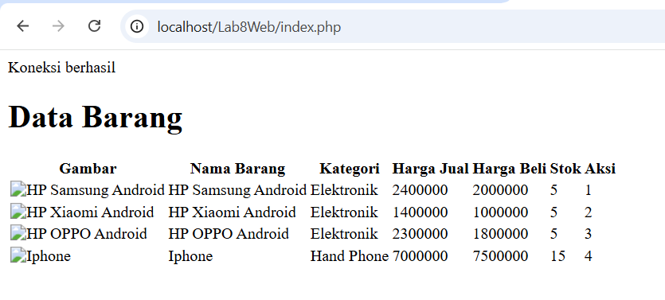

7. Mengubah Data (Update)

Buat file ubah.php untuk mengedit data barang yang sudah tersimpan di database.

Data barang akan ditampilkan berdasarkan ID barang. Setelah dilakukan perubahan, data disimpan kembali menggunakan perintah SQL UPDATE.

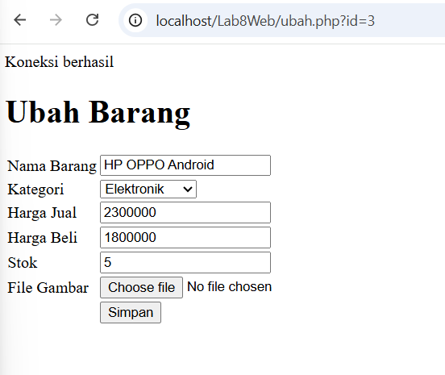

8. Menghapus Data (Delete)

Buat file hapus.php untuk menghapus data barang berdasarkan ID barang.

Proses penghapusan menggunakan perintah SQL DELETE. Setelah data berhasil dihapus, halaman akan diarahkan kembali ke index.php.

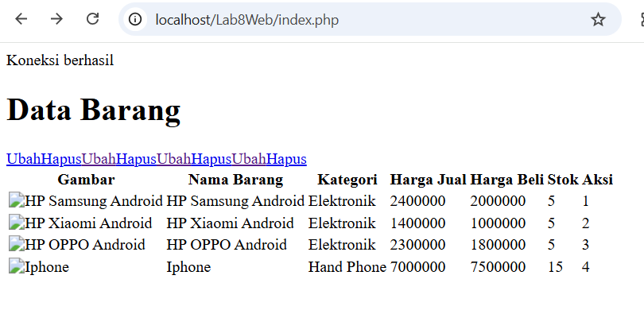

📸 Hasil Praktikum

Pada praktikum ini telah dibuat aplikasi pengelolaan data barang berbasis web menggunakan PHP dan MySQL dengan fitur CRUD.

Fitur yang tersedia:

Create: Menambahkan data barang baru.

Read: Menampilkan data barang dari database.

Update: Mengubah informasi barang.

Delete: Menghapus data barang.

Hasil yang sudah diberi di perbaiki dan di beri style css

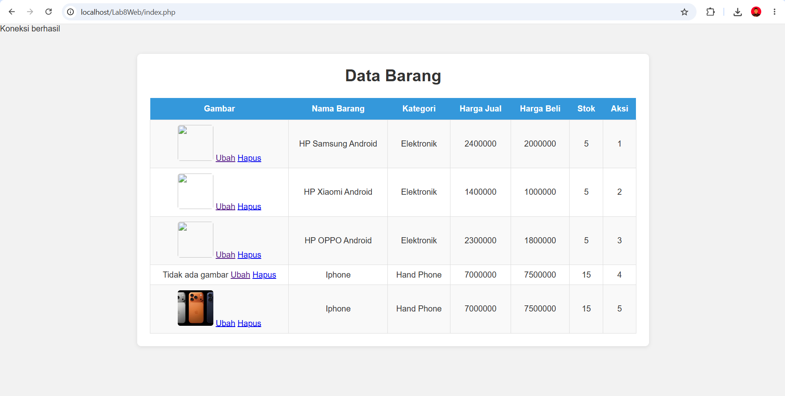

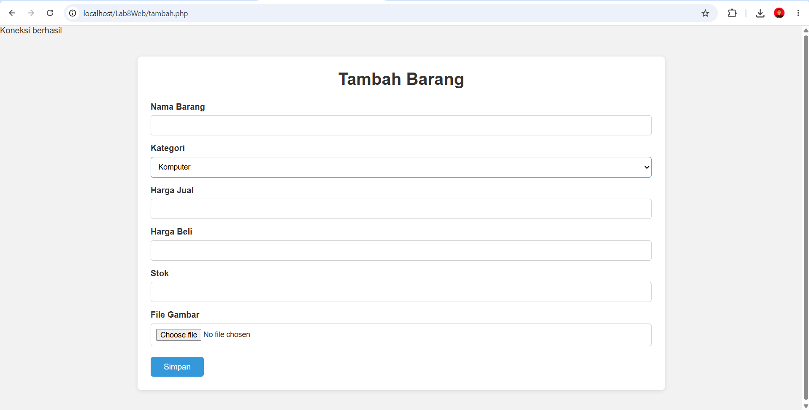

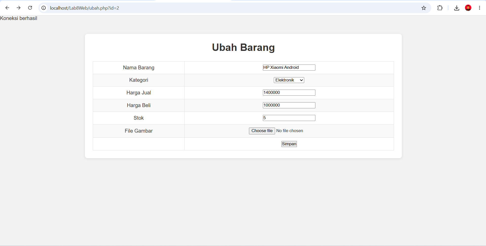

# 📝 Kesimpulan

Berdasarkan praktikum yang telah dilakukan, dapat disimpulkan bahwa PHP dapat digunakan untuk menghubungkan aplikasi web dengan database MySQL. Dengan menerapkan konsep CRUD, pengguna dapat melakukan pengelolaan data barang mulai dari menambahkan, menampilkan, mengubah, hingga menghapus data.

Praktikum ini memberikan pemahaman mengenai penggunaan database MySQL, koneksi database menggunakan PHP, serta penerapan operasi CRUD dalam pembuatan aplikasi web sederhana.